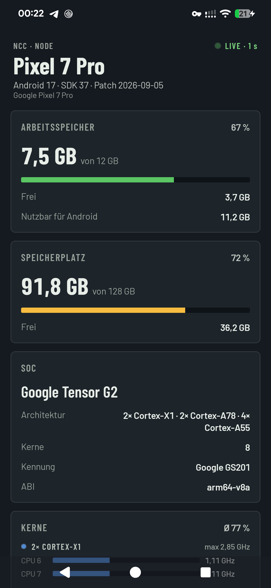
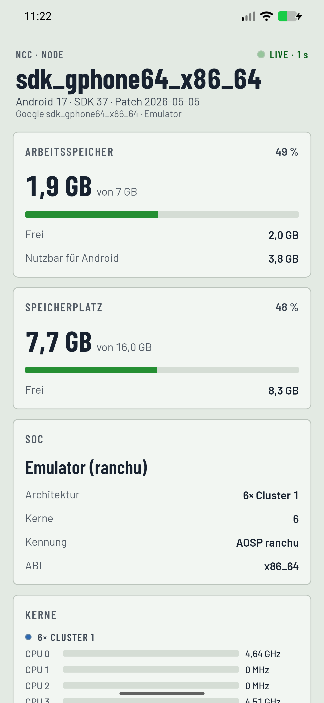
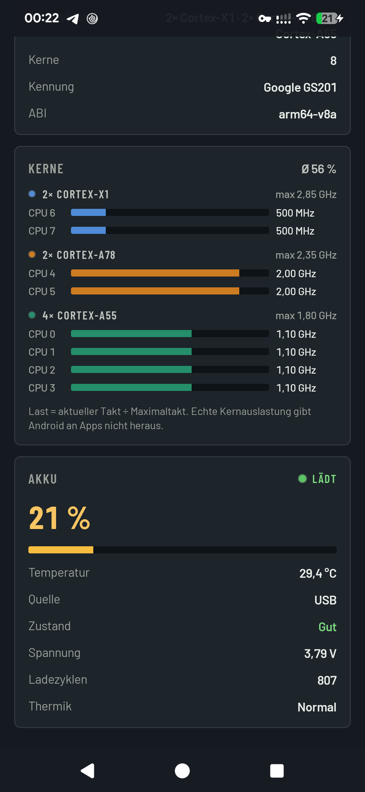
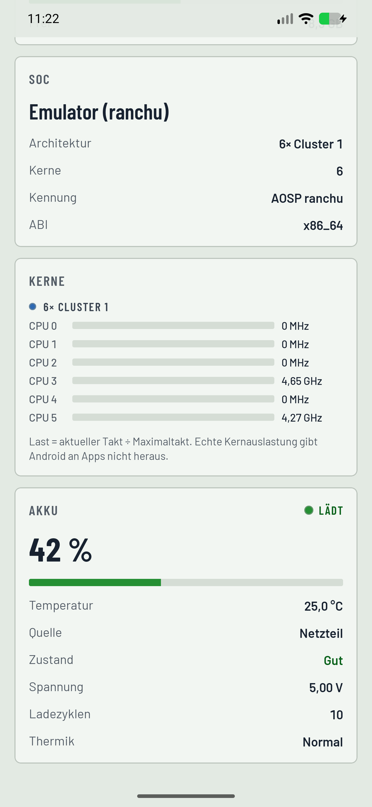
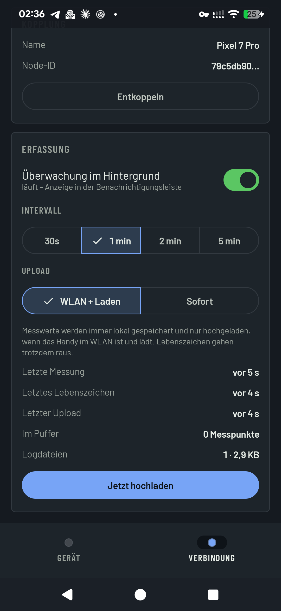
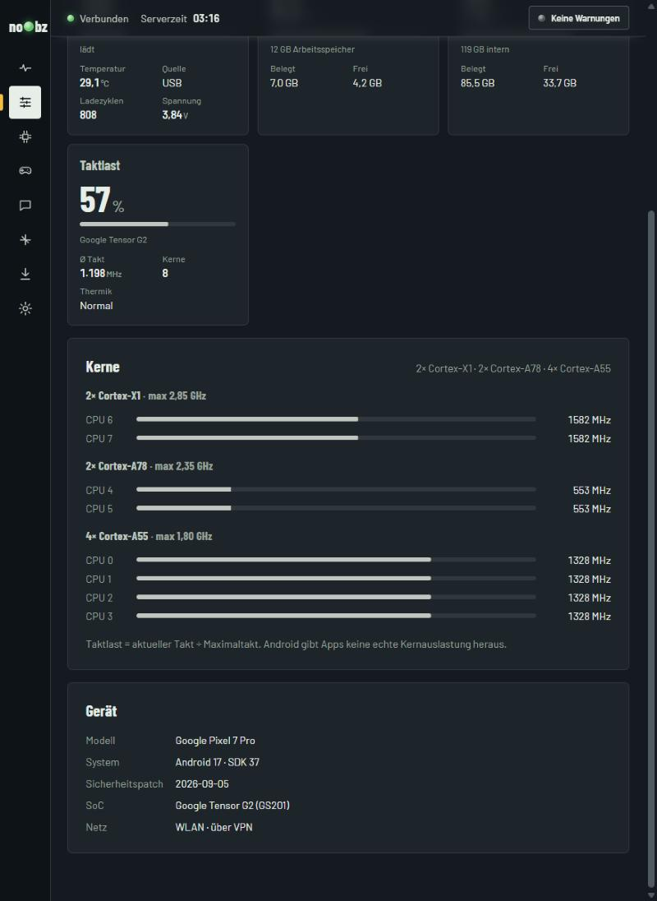
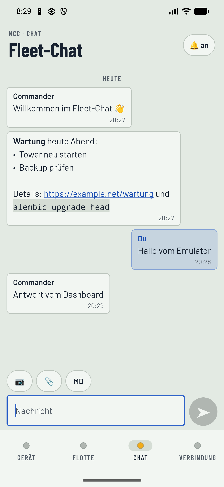
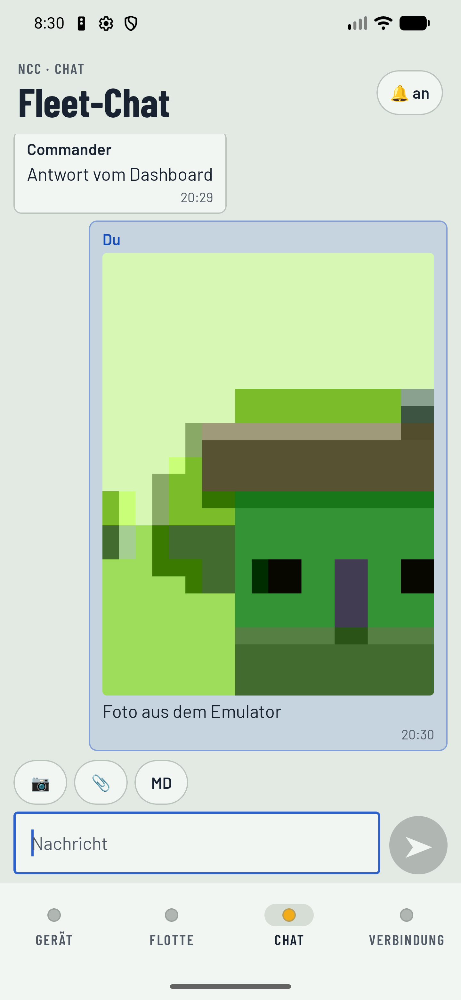
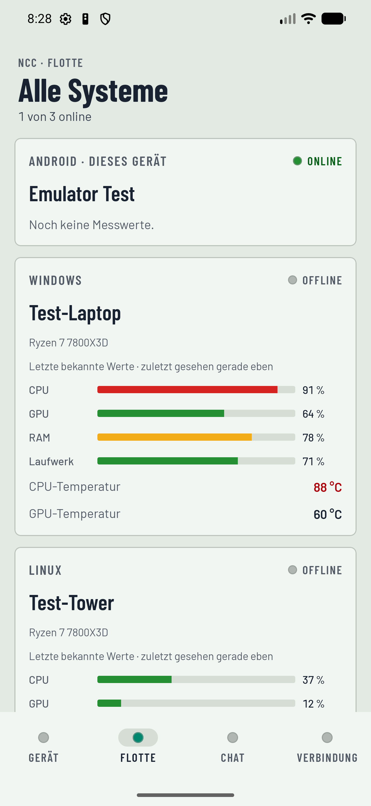

# NCC Android

Native Android-App (Kotlin + Jetpack Compose) für das no0bz Command Center (NCC).
Das Handy wird zum NCC-Node: Gerätedaten, Live-Modus, Warnungen, Fleet-Chat mit Kamera und
optionale GPS-Heatmap – alles über Tailscale zum eigenen NCC-Server.

- Konzept: [docs/KONZEPT.md](docs/KONZEPT.md)
- Server und Dashboard: dieses Repository (`backend/ncc_server`, `frontend`)

## Entwicklungsumgebung

| Werkzeug | Hinweis |
|---|---|
| Android Studio | bringt SDK, Emulator und ein passendes JDK (`jbr`) mit |
| Android SDK | `ANDROID_HOME` setzen bzw. `sdk.dir` in `local.properties` |
| JDK für Gradle | 17 oder neuer, z. B. das `jbr` aus Android Studio |
| Emulator | z. B. Pixel 7 Pro, API 37, Google-Play-Image |

## Bauen und starten

```powershell
cd android
$env:JAVA_HOME = '<Android Studio>\jbr'
.\gradlew.bat testDebugUnitTest assembleDebug
adb install -r app\build\outputs\apk\debug\app-debug.apk
```

Die App fragt beim ersten Koppeln nach der Server-Adresse (z. B. `http://100.x.y.z:8350`).
HTTP ist nur für Tailscale-Adressen (100.64.0.0/10, `*.ts.net`) und lokale Testadressen erlaubt.

## Stand

**M1 – Grundgerüst** ✅ (getestet auf Pixel 7 Pro / Android 17 und Emulator API 37)

- Dashboard im NCC-Look (Barlow, Signalfarben, Hell/Dunkel), lokal live jede Sekunde
- Gerätename, Android-Version, RAM, Speicher, SoC (z. B. Tensor G2), Kern-Architektur je Cluster,
  Takt je Kern, Akku (Stand, Laden, Temperatur, Zustand, Spannung, Zyklen), Thermik

| Pixel 7 Pro | Emulator |
|---|---|
|  |  |
|  |  |

**M2 – Kopplung + Upload** ✅ (End-to-End getestet gegen einen lokalen NCC-Server)

- Tab „Verbindung“: Tailscale- und Server-Status, Kopplung über das Dashboard
  („Aufnahme → Kopplungsanfragen“), Agent-Token verschlüsselt im Android Keystore
- Hintergrunddienst mit Intervall 30 s / 1 / 2 / 5 min, Lebenszeichen, Upload-Regel
  „WLAN + Laden“ oder „Sofort“, Tages-Logdateien (`files/logs/JJJJ-MM-TT.jsonl`) als Puffer
- Messwerte im Format der PC-Agents (RAM, Speicher, Akku, System) plus Abschnitt `android`



**M3 – Live-Modus + Warnungen** ✅ (End-to-End getestet: Pixel 7 Pro, lokaler Server, Dashboard im Browser)

- Live-Kanal (WebSocket) zum Server, solange das Handy gekoppelt ist; Neuaufbau mit Backoff
- Öffnet jemand das Handy im Dashboard, streamt es alle 2 s – sonst nicht (spart Akku und Daten)
- NCC-Warnungen als Benachrichtigung, „Behoben“-Meldung, kein Doppelmelden nach Neuverbinden
- Schalter „Warnungen aufs Handy“ und „Live nur im WLAN“, Hinweis auf die Akku-Optimierung
- Dashboard: eigene Android-Ansicht (Akku, RAM, Speicher, Taktlast, Kerne je Cluster, Gerät) und
  Schalter „Warnungen an gekoppelte NCC-Apps“ unter Einstellungen → Warnregeln



**M4 – Chat, Kamera und Flotte** ✅ (End-to-End im Emulator gegen einen lokalen NCC-Server getestet)

- Tab „Chat“: derselbe Fleet-Chat wie im Dashboard – Text, Markdown, Anhänge ansehen und senden,
  Zurückblättern, neue Nachrichten sofort über den Live-Kanal, Benachrichtigung bei geschlossenem Chat
- Kamera: Foto mit der Kamera-App aufnehmen, wird verkleinert (max. 2560 px) und direkt hochgeladen;
  die App braucht dafür keine Kamera-Berechtigung
- Tab „Flotte“: alle Systeme mit Status, CPU, GPU, RAM, Laufwerk, Akku und Temperaturen
  (Commander-Handys sehen alle Geräte, andere nur die eigenen)

| Chat | Foto | Flotte |
|---|---|---|
|  |  |  |

Nächster Schritt: **M5 – GPS-Heatmap** (siehe [Konzept](docs/KONZEPT.md#7-meilensteine)).
